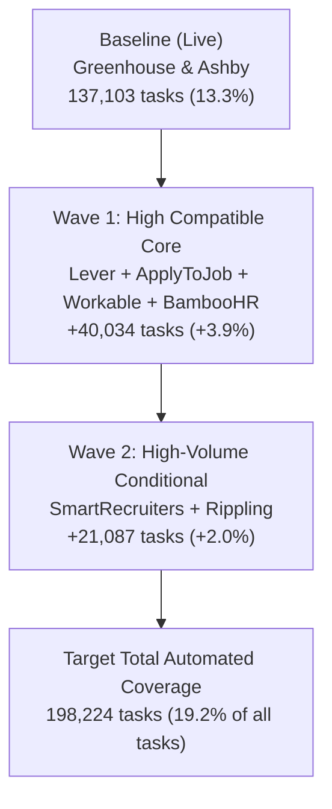

# ATS Expansion Analysis — Highest ROI Single-Page Applications

## Why This Analysis Was Done
Our operational goal is to maximize automated job application coverage for ApplyWizz candidates by expanding beyond **Greenhouse** and **Ashby**. 

To maximize developer ROI and submission success rates, we strictly target **single-page application forms** that require **no candidate account / password creation**, matching our proven Greenhouse and Ashby Playwright automation architecture.

We analyzed 30 days of production job and task volume (`last_30_days_diff_platform_jobs&tasks_count_202610071604.xlsx` across 31 daily snapshots: **1,029,322 total tasks** and **261,460 total jobs** across 80 unique domains) to identify and prioritize the highest-yield ATS platforms.

---

## Current Baseline

| Platform | 30-Day Tasks | 30-Day Jobs | % of Total System Tasks | Architecture Status |
| :--- | :---: | :---: | :---: | :--- |
| **Greenhouse** | **79,231** | 16,088 | 7.70% | ✅ Fully automated in production |
| **Ashby** | **57,872** | 9,660 | 5.62% | ✅ Fully automated in production |
| **Current Baseline Total** | **137,103** | **25,748** | **13.32%** | **Core single-page engine** |

---

## 1. High-Compatibility Platforms (Pure Single-Page, Drop-In Fit)
*These platforms share the identical architectural pattern as Greenhouse and Ashby: single-page public form, standard file upload input, zero login barriers, and clean DOM inputs.*

| Priority | Platform | 30-Day Tasks | 30-Day Jobs | % of System Tasks | Key Technical Insights |
| :---: | :--- | :---: | :---: | :---: | :--- |
| **1** | **Lever** | **15,690** | 3,528 | 1.52% | Standard single-page apply at `jobs.lever.co/<org>/<id>/apply`. Extremely clean DOM, standard file input, predictable custom questions. Lowest engineering friction. |
| **2** | **ApplyToJob (JazzHR)** | **9,668** | 2,658 | 0.94% | Single-page form directly beneath the job post. Classic HTML form elements, standard file input, easily automated. |
| **3** | **Workable** | **7,514** | 2,230 | 0.73% | Single-page React form at `apply.workable.com/j/<id>/apply`. Predictable field types and file dropzones. |
| **4** | **BambooHR** | **7,162** | 2,302 | 0.70% | Single-page form / slide-over drawer on job posting. Clean and standard field schema. |
| **5** | **Pinpoint** | **2,367** | 711 | 0.23% | Modern single-page ATS architected almost identically to Ashby. Accessible, semantic DOM. |
| **6** | **Teamtailor** | **939** | 407 | 0.09% | Modern branding ATS with single-page modal or inline form. |
| **7** | **Comeet** | **516** | 97 | 0.05% | Single-page modal application form. |
| **8** | **100Hires** | **503** | 358 | 0.05% | Modern lightweight single-page ATS. |
| **9** | **Recruitee** | **419** | 197 | 0.04% | Clean single-page form at `<org>.recruitee.com/o/<id>/apply`. |
| **10** | **Recruiterflow** | **394** | 145 | 0.04% | Single-page candidate submission form. |
| **11** | **Occupop** | **194** | 228 | 0.02% | Simple single-page apply form. |
| **12** | **Personio** | **105** | 48 | 0.01% | Standard European single-page application form. |
| **13** | **JobScore** | **61** | 9 | 0.01% | Single-page form with resume parser. |
| **14** | **Freshteam** | **2** | 2 | <0.01% | Freshworks single-page apply widget. |
| — | **Tier 1 Total** | **45,534** | **12,920** | **4.42%** | *Top 4 (Lever, JazzHR, Workable, BambooHR) capture 40,034 tasks.* |

---

## 2. Conditional Automation Platforms (Single-Page with Specific Quirks)
*Single-page candidate submission exists, but requires specialized handling for shadow DOM, iframes, tenant variations, or optional login walls.*

| Priority | Platform | 30-Day Tasks | 30-Day Jobs | % of System Tasks | Specific Automation Challenge / Condition |
| :---: | :--- | :---: | :---: | :---: | :--- |
| **1** | **SmartRecruiters** | **11,525** | 3,735 | 1.12% | Modern jobs feature a 1-page "Smartr" form, but enterprise configs occasionally enforce multi-step questionnaires or candidate account creation. |
| **2** | **Rippling** | **9,562** | 1,994 | 0.93% | Single-page apply, but rendered inside Web Components / Shadow DOM and occasional company SSO redirects. |
| **3** | **CareerPlug** | **3,574** | 1,015 | 0.35% | Lightweight no-account form, but frequently embedded inside employer site iframes. |
| **4** | **ApplicantPro** | **3,046** | 843 | 0.30% | 1-to-2 step form without login, but older tenants use legacy table-based DOM layouts. |
| **5** | **CareersPage** | **1,806** | 328 | 0.18% | Custom career page builder; single page but DOM class names and layouts vary per client. |
| **6** | **Apploi** | **1,623** | 518 | 0.16% | Healthcare ATS; single-page mobile form, but frequently enforces SMS phone verification. |
| **7** | **HireBridge** | **1,292** | 295 | 0.13% | Older single/two-page layout; DOM structure varies by client branding. |
| **8** | **Zoho Recruit** | **1,230** | 360 | 0.12% | Often embedded as a remote webform/iframe with varied custom fields per company. |
| **9** | **Crelate** | **761** | 222 | 0.07% | Agency staffing ATS; public forms are single-page, but some redirect to recruiter inboxes. |
| **10** | **ClearCompany** | **559** | 170 | 0.05% | Streamlined form, but nested cross-origin iframes on company career sites. |
| **11** | **Fountain** | **534** | 106 | 0.05% | Hourly/frontline hiring; no password required, but uses dynamic branching qualification rules. |
| **12** | **Loxo** | **521** | 149 | 0.05% | Staffing ATS; public job forms are single page, but heavily reliance on custom question types. |
| **13** | **HireClick** | **501** | 102 | 0.05% | Small business ATS; simple 1-page form, relatively low volume. |
| **14** | **Agile ATS** | **443** | 109 | 0.04% | Niche ATS; simple form. |
| **15** | **JobAdder** | **78** | 97 | 0.01% | Embeddable single-page widget; low standalone direct volume. |
| — | **Tier 2 Total** | **37,055** | **10,043** | **3.60%** | *SmartRecruiters & Rippling comprise 57% of all conditional volume.* |

---

## 3. Out-of-Scope (Multi-Step / Account-Walled / Aggregators)
*The remaining platforms in the dataset are intentionally excluded from single-page automation:*
- **Enterprise Multi-Step / Account Wizards**: Workday (178k tasks), Oracle Cloud (33k), Phenom (33k), ADP (32k), iCIMS (23k), Paylocity (18k), UKG / UltiPro (18k), Dayforce (14k), Paycom (11k), Oracle Taleo (10k), SAP SuccessFactors (4.5k), Cornerstone (3k), etc. (Require complex multi-step state machines and candidate credential management).
- **Aggregators / Job Boards / Distributors**: Appcast (18.6k), LinkedIn (11.5k), ContactHR (10.6k), Indeed (5.7k), Recruitics (3.6k), GovernmentJobs (1.8k), TheLadders (1.3k), BioSpace (1.1k), etc.

---

## Next Steps: Roadmap for Integration

1. **Wave 1 Target 1: Lever (`jobs.lever.co`)**
   - Implement `src/scanner/leverScanner.ts` (API/DOM scanner).
   - Implement `src/submitter/leverSubmitter.ts` using our centralized Playwright stealth infrastructure.
   - Wire `ats: 'lever'` into `atsDetector.ts` and submission queues.
   - **Impact**: +15,690 tasks/month.
2. **Wave 1 Target 2: ApplyToJob / JazzHR (`applytojob.com`)**
   - Standard HTML form filling; very low failure rate.
   - **Impact**: +9,668 tasks/month.
3. **Wave 1 Target 3 & 4: Workable & BambooHR**
   - Clean single-page forms.
   - **Impact**: +14,676 tasks/month combined.
4. **Wave 2: SmartRecruiters & Rippling**
   - Handle shadow DOM piercing (Rippling) and Smartr 1-page filter (SmartRecruiters).
   - **Impact**: +21,087 tasks/month.
